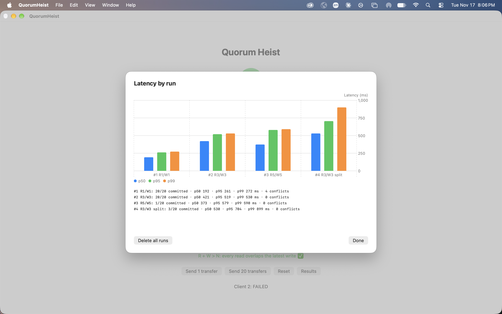
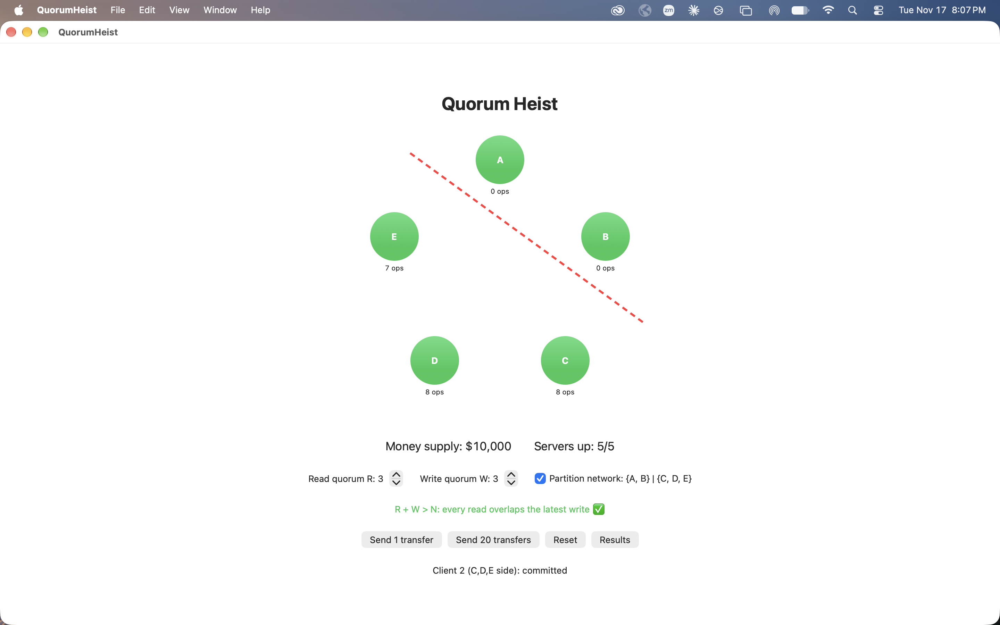
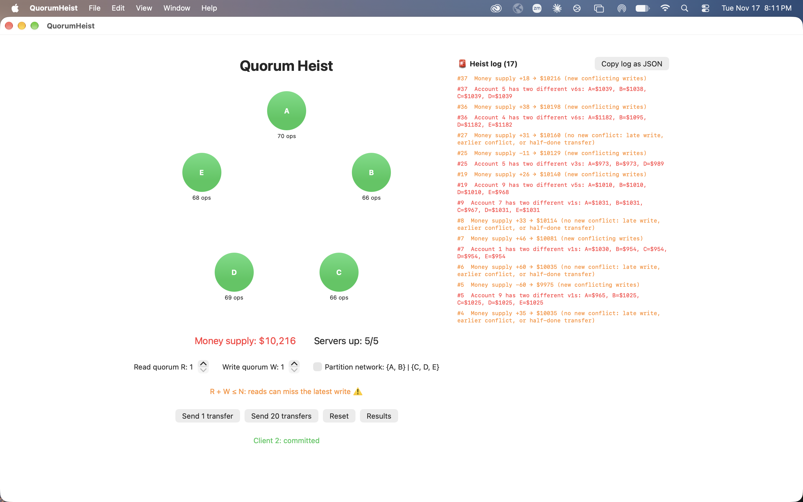
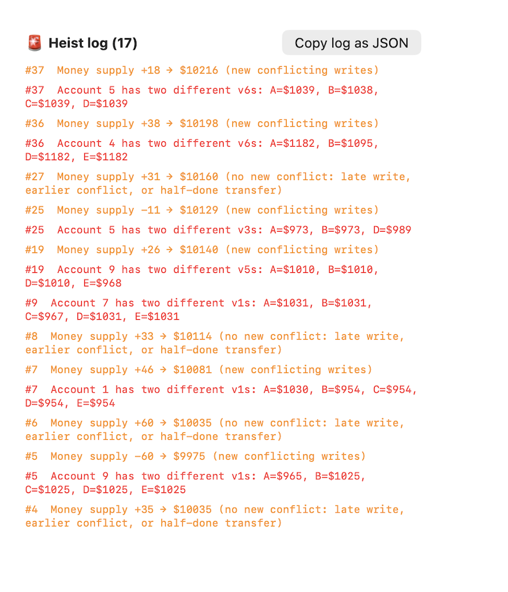
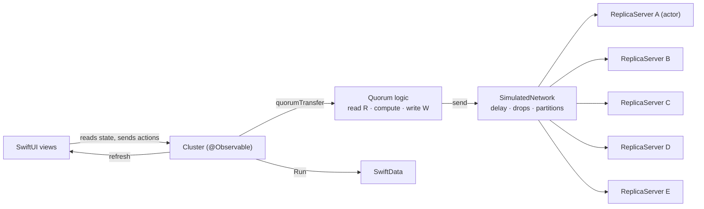

# Quorum Heist

**A replicated bank you can break on purpose.** Five servers each hold a copy of the same ledger, connected by a deliberately unreliable network. Turn the quorum dials, crash servers, cut the network in half, and watch money appear or disappear. A built-in detector names the exact transfer that caused it.

Built in Swift 6 and SwiftUI for macOS, as a hands-on way to learn Swift concurrency and distributed-systems fundamentals: replication, quorums, partitions and the CAP tradeoff.

---

## What it shows

| You do this | You see this |
|---|---|
| Send transfers at **R=3, W=3** | Money stays at exactly $10,000 |
| Drop to **R=1, W=1** | Stale reads; the money supply drifts and the screen flashes red |
| Crash servers | Replicas fall behind; at R=5/W=5 one crash makes every transfer fail |
| **Partition** the network into {A, B} \| {C, D, E} | At 3/3 the minority side is locked out but the money stays correct (CP). At 1/1 both sides keep writing and corrupt the books (AP, split brain) |
| Open **Results** | p50 / p95 / p99 latency for every saved run, charted |

---

## Results

Every number below was measured in the app. Each run is a single batch of 20 transfers, so treat them as illustrative rather than statistically tight.

### Consistency vs latency (20 transfers per run, 10% message loss, 20–200 ms per hop)

| Setting | Committed | p50 ms | p95 ms | p99 ms | Conflicts |
|---|---|---|---|---|---|
| R=1, W=1 | 20/20 | 192 | 261 | 272 | 4 |
| R=3, W=3 | 20/20 | 421 | 519 | 530 | 0 |
| R=5, W=5 | 1/20 | 373 | 579 | 590 | 0 |
| R=3, W=3, partitioned | 3/20 | 530 | 704 | 899 | 0 |

An earlier set of runs gave the same picture: 1/1 at a 195 ms median with 3 conflicts, 3/3 at 390–394 ms with none, 5/5 committing 4 of 20, and partitioned 3/3 at 523–527 ms.

- **Majority quorums cost about 2× latency and buy correctness:** median 421 ms vs 192 ms, with 0 conflicts vs 4.
- **5/5 looks fast but is broken:** only 1 of 20 transfers committed. Failed transfers give up early, which pulls the percentiles down. Latency without the success rate is misleading.
- **During a partition, latency becomes the timeout:** the median sits just above the 500 ms timeout because half the transfers can never reach a quorum.
- **The commit counts match the math:** at 3/3 each step needs 3 of 5 replies (≈99%), so ≈19 of 20 transfers should commit. Partitioned, only one client's 10 transfers can work, each needing all 3 of its servers on 4 steps: 10 × 0.9^12 ≈ 3.

### Same partition, two choices

| R=3, W=3: consistent, minority side locked out (CP) | R=1, W=1: everyone keeps working, books corrupted (AP) |
|---|---|
|  |  |

With R=1, W=1 and the network partitioned, both halves kept accepting transfers. In one recorded run, after 20 transfers the money supply read **$9,987**: $13 destroyed by conflicting writes. Healing the partition did not restore it. <!-- TODO: if your partition-ap.png shows a different money supply, swap in that number so the text matches the picture -->

### Conflict rate with and without a partition (R=1, W=1)

| Condition | Transfers | Conflicts detected |
|---|---|---|
| No partition | 40 | 2 |
| Partitioned | 20 | 10 |

8 of the 10 partitioned conflicts split exactly along the partition line (A and B agreeing against C, D and E). A partition turns a brief inconsistency window into a permanent one.

### Data race, before replication

10,000 concurrent transfers against an unprotected shared balance ended at **$10,018** in one run: money created by lost updates. The same transfers against a Swift `actor` ended at exactly $10,000 every time.

---

## How it works

One transfer (say account 3 → account 7, $20):

1. **Quorum read** account 3 from all 5 servers in parallel. Keep the highest version among the first R replies; time out after 500 ms.
2. **Quorum read** account 7 the same way.
3. **Compute** the new balances and bump each account's version.
4. **Quorum write** both accounts in parallel. Each write returns after W acks; the remaining writes keep propagating in the background (eventual consistency).
5. **Check for a heist:** group every account copy by (account, version). Two different balances at the same version means two writers diverged, so the app flashes red and logs it.

Each server is a Swift `actor`, so calling it stands in for sending a network message. Every message passes through `SimulatedNetwork`, which adds a 20–200 ms delay, drops 10% of messages, and never delivers across a partition.

### Project layout

| File | Role |
|---|---|
| `Models.swift` | `Account`, `Ledger`, `Transfer`, `ServerNode` |
| `ReplicaServer.swift` | A server: versioned reads and writes, can be crashed |
| `Network.swift` | Generic `Network` protocol and the lossy `SimulatedNetwork` |
| `Quorum.swift` | `quorumRead`, `quorumWrite`, `quorumTransfer` |
| `Timeout.swift` | Generic `withTimeout`, racing work against a clock |
| `Cluster.swift` | Runs the clients, mirrors server state for the UI, detects heists |
| `Heist.swift` | Conflict detection and the JSON-exportable anomaly log |
| `Stats.swift`, `Run.swift`, `ResultsView.swift` | Percentiles, SwiftData persistence, Swift Charts |
| `UnsafeBank.swift` | The data-race demo: unsafe class vs `actor` |

---

## Swift concepts used

Value vs reference types · enums with associated values · protocols and generics · optionals · `throws` / `do-catch` · `async`/`await` · task groups and cancellation · actors and `Sendable` (Swift 6 strict concurrency) · `@Observable` · SwiftData · Swift Charts · `Codable` / `Hashable` / `Equatable`

---

## Running it

1. Clone the repo and open the `.xcodeproj` in Xcode.
2. Select the **My Mac** destination and press **⌘R**.

Built and tested on macOS 27.2 with Xcode 27 in Swift 6 language mode. <!-- TODO: confirm your Xcode version via Xcode → About Xcode -->

---

## Limitations

- **It's a simulation.** All five servers run in one process; the "network" is an in-memory delay and a coin flip, not real sockets.
- **No transactions.** A transfer is two separate writes, so if one reaches its quorum and the other doesn't, the transfer is half-done. Quorums don't fix that; real systems use transactions or consensus (Raft, Paxos).
- **No repair.** A server that misses writes stays stale until a newer version overwrites it. There is no read repair or anti-entropy.
- **Small samples.** Each result is one batch of 20 transfers.

---

## What I learned

<!-- TODO: write 3–4 bullets in your own words. For example: the moment the unsafe bank printed $10,018, why R + W > N works, why a bank should choose consistency over availability during a partition. -->
